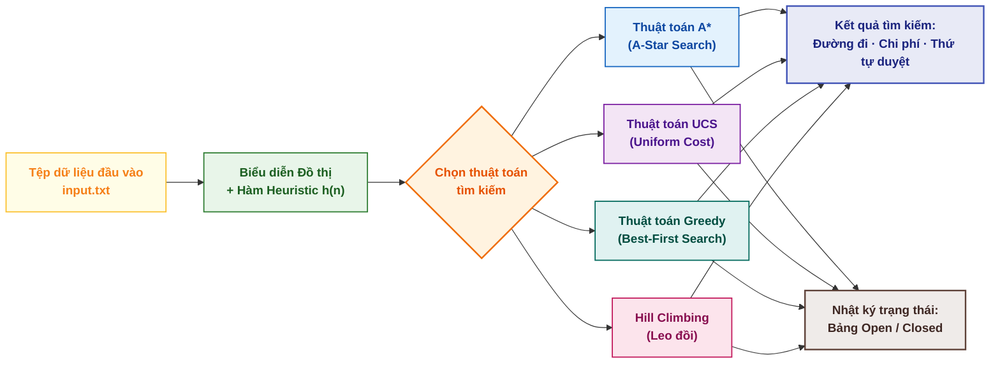
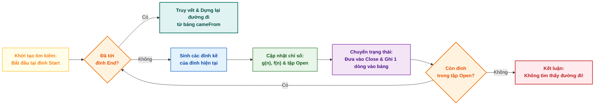

<div align="center">

# PathFinder: Website trực quan hóa các thuật toán tìm đường trong không gian trạng thái (A*, UCS, Greedy, Hill Climbing)
[](https://huynhthanhphong231004it.github.io/Artificial_Intelligence_CT332/)


**CT332 – Trí tuệ nhân tạo - Trường CNTT&TT, Đại học Cần Thơ**

Sinh viên thực hiện: Huỳnh Thanh Phong (MSSV: B2207555)
Giáo viên hướng dẫn: TS. Lưu Tiến Đạo

[](https://www.facebook.com/huynh.thanh.phong.561667)
[](https://www.tiktok.com/@reorioll)
[](https://www.youtube.com/@ReoRioll-2304CICTCTU)


</div>

---

## 1. Tóm tắt

Ứng dụng web cho phép nạp đồ thị từ file `.txt` → chọn đỉnh đầu/cuối → chọn thuật toán → xem đường đi, thứ tự duyệt và bảng Open/Close từng bước.



<table>
  <thead>
    <tr style="background-color: #1565C0; color: white;">
      <th width="25%">Thành phần</th>
      <th width="30%">Công nghệ / Thư viện</th>
      <th width="45%">Vai trò & Chức năng chi tiết</th>
    </tr>
  </thead>
  <tbody>
    <tr>
      <td><b>Giao diện người dùng</b></td>
      <td><code>HTML5</code> · <code>Bootstrap 5</code></td>
      <td>Xây dựng bố cục Responsive, tối ưu trải nghiệm trực quan và tương thích đa thiết bị.</td>
    </tr>
    <tr style="background-color: #f8f9fa;">
      <td><b>Trực quan hóa đồ thị</b></td>
      <td><code>vis-network</code></td>
      <td>Dựng mạng lưới nút (nodes) và cạnh (edges) động, hỗ trợ kéo thả và tương tác thời gian thực.</td>
    </tr>
    <tr>
      <td><b>Xử lý thuật toán</b></td>
      <td><code>JavaScript (ES6+)</code></td>
      <td>Thực thi các thuật toán tìm kiếm hoàn toàn phía Client, không phụ thuộc Server/Backend.</td>
    </tr>
  </tbody>
</table>

---

## 2. Phương pháp

\- Luồng xử lý chung: Quy trình bắt đầu bằng việc tải và phân tích tệp dữ liệu đầu vào để trích xuất cấu trúc đỉnh, cạnh cùng giá trị h(n), từ đó hiển thị đồ thị trực quan cho người dùng. Sau khi cấu hình các tham số về điểm đầu, điểm cuối và chọn giải thuật mong muốn, hệ thống sẽ tiến hành thực thi quá trình tìm kiếm. Trong suốt quá trình chạy, từng bước di chuyển được ghi nhận chi tiết vào bảng nhật ký Open/Closed trước khi hiển thị kết quả hoàn chỉnh về đường đi, chi phí và thứ tự duyệt.

```mermaid
flowchart LR
    %% Định nghĩa phong cách màu sắc chuẩn Academic (Paper-Ready Multi-Color)
    classDef inputNode fill:#FFFDE7,stroke:#FBC02D,stroke-width:1.5px,color:#F57F17,font-weight:bold;
    classDef parseNode fill:#E3F2FD,stroke:#1565C0,stroke-width:1.5px,color:#0D47A1,font-weight:bold;
    classDef dataNode fill:#FFF3E0,stroke:#EF6C00,stroke-width:1.5px,color:#E65100,font-weight:bold;
    classDef renderNode fill:#E8F5E9,stroke:#2E7D32,stroke-width:1.5px,color:#1B5E20,font-weight:bold;
    classDef userNode fill:#F3E5F5,stroke:#7B1FA2,stroke-width:2px,color:#4A148C,font-weight:bold;
    classDef algoNode fill:#E0F2F1,stroke:#00695C,stroke-width:1.5px,color:#004D40,font-weight:bold;
    classDef logNode fill:#FCE4EC,stroke:#C2185B,stroke-width:1.5px,color:#880E4F,font-weight:bold;
    classDef resultNode fill:#E8EAF6,stroke:#3F51B5,stroke-width:2px,color:#1A237E,font-weight:bold;

    %% Các nút trong sơ đồ
    A["Tải tệp dữ liệu đầu vào<br/>(Chọn file input.txt)"]:::inputNode
    B["Phân tích cú pháp tệp<br/>parseInputFile()"]:::parseNode
    
    C["Trích xuất cấu trúc dữ liệu:<br/>Danh sách Đỉnh, Cạnh &amp; Giá trị h(n)"]:::dataNode
    D["Trực quan hóa đồ thị drawGraph():<br/>Vẽ đồ thị có hướng + Hiển thị h(n)"]:::renderNode
    
    E["Thiết lập tham số tìm kiếm:<br/>Nhập Start, End &amp; Chọn Giải thuật"]:::userNode
    F["Thực thi Giải thuật:<br/>Gọi hàm thuật toán tương ứng"]:::algoNode
    
    G["Nhật ký trạng thái từng bước:<br/>Ghi vào bảng kết quả Open / Closed"]:::logNode
    H["Xuất kết quả trực quan:<br/>Hiển thị Path, Cost &amp; Traversal Order"]:::resultNode

    %% Luồng liên kết
    A --> B
    B --> C
    C --> D
    D --> E
    E --> F
    F --> G
    G --> H
```



\- Định dạng input: Định dạng tệp dữ liệu được quy định rõ ràng gồm hai phần chính: dòng đầu tiên dùng để khai báo danh sách tất cả các đỉnh trong đồ thị kèm theo giá trị hàm heuristic h(n) tương ứng (theo cấu trúc tên_đỉnh giá_trị_h), trong khi các dòng tiếp theo dùng để mô tả các cạnh nối giữa các đỉnh cùng với trọng số của từng cạnh (theo cấu trúc từ_đỉnh đến_đỉnh trọng_số).

```
A 5 B 3 C 0          # dòng 1: đỉnh và giá trị h  → "đỉnh h đỉnh h ..."
A B 2                # các dòng sau: "từ đến trọng_số"
B C 4
```

Đồ thị có hướng, trọng số cạnh dương, `h` là heuristic của từng đỉnh.

Bốn thuật toán

<table>
  <thead>
    <tr style="background-color: #1565C0; color: white;">
      <th width="22%">Thuật toán (File)</th>
      <th width="30%">Điều kiện chọn đỉnh mở rộng</th>
      <th width="28%">Cấu trúc dữ liệu</th>
      <th width="20%">Xác định tối ưu</th>
    </tr>
  </thead>
  <tbody>
    <tr>
      <td><b>A* Search</b><br/><code>gtAsao.js</code></td>
      <td><code>f(n) = g(n) + h(n)</code> nhỏ nhất</td>
      <td><b>Open + Close</b><br/><small style="color: #1565c0;">(Có cập nhật khi thấy đường tốt hơn)</small></td>
      <td><span style="color: #2e7d32; font-weight: bold;">Có</span><br/><small>(Hàm <i>h</i> chấp nhận được)</small></td>
    </tr>
    <tr style="background-color: #f8f9fa;">
      <td><b>UCS</b><br/><code>UCS.js</code></td>
      <td><code>g(n)</code> nhỏ nhất</td>
      <td><b>Open + Close</b></td>
      <td><span style="color: #2e7d32; font-weight: bold;">Có</span></td>
    </tr>
    <tr>
      <td><b>Greedy Best-First</b><br/><code>Greedy.js</code></td>
      <td><code>h(n)</code> nhỏ nhất</td>
      <td><b>Close</b></td>
      <td><span style="color: #c62828; font-weight: bold;">Không</span></td>
    </tr>
    <tr style="background-color: #f8f9fa;">
      <td><b>Hill Climbing</b><br/><code>hillClimbing.js</code></td>
      <td>Láng giềng chưa duyệt có <code>h(n)</code> nhỏ nhất</td>
      <td><b>Close</b></td>
      <td><span style="color: #c62828; font-weight: bold;">Không</span><br/><small>(Có thể kẹt cực trị cục bộ)</small></td>
    </tr>
  </tbody>
</table>



Cấu trúc thư mục

```
├── index.html        # giao diện + bố cục 3 cột
├── javascript.js     # đọc file, vẽ đồ thị, điều phối thuật toán
├── gtAsao.js         # A*
├── UCS.js            # Uniform Cost Search
├── Greedy.js         # Greedy Best-First
├── hillClimbing.js   # Hill Climbing
└── input*.txt        # đồ thị mẫu
```

---

## 3. Đóng góp

So với các công cụ minh họa tìm kiếm thường gặp (chỉ hoạt ảnh đường đi trên lưới/mê cung, hoặc mã giáo trình chạy console):

<table>
  <thead>
    <tr style="background-color: #1565C0; color: white;">
      <th width="20%">Tiêu chí</th>
      <th width="35%">Công cụ thông thường</th>
      <th width="45%">Dự án này (Academic Solution)</th>
    </tr>
  </thead>
  <tbody>
    <tr>
      <td><b>Dữ liệu đầu vào</b></td>
      <td>Cố định sẵn hoặc vẽ tay thủ công trên lưới lưới ô vuông (grid)</td>
      <td><span style="color: #1b5e20; font-weight: bold;">Đồ thị bất kỳ nạp từ file <code>.txt</code></span>, kèm giá trị hàm heuristic <code>h</code></td>
    </tr>
    <tr style="background-color: #f8f9fa;">
      <td><b>Quá trình chạy</b></td>
      <td>Chỉ hiển thị kết quả cuối cùng hoặc hoạt ảnh đồ họa ẩn chi tiết</td>
      <td><span style="color: #1b5e20; font-weight: bold;">Bảng nhật ký từng bước chi tiết</span>: đỉnh xét → đỉnh sinh → Open → Close, kèm vector <code>(cha, g, h, f)</code></td>
    </tr>
    <tr>
      <td><b>Đa dạng giải thuật</b></td>
      <td>Thường chỉ hỗ trợ cố định 1 đến 2 thuật toán đơn lẻ</td>
      <td><span style="color: #1b5e20; font-weight: bold;">4 thuật toán trên cùng một giao diện</span>, cùng một tập input để đối chiếu trực tiếp</td>
    </tr>
    <tr style="background-color: #f8f9fa;">
      <td><b>Xử lý giới hạn</b></td>
      <td>Thường bỏ qua hoặc không nêu rõ các trường hợp đặc biệt</td>
      <td><span style="color: #c62828; font-weight: bold;">Cơ chế bắt lỗi thông minh</span>: Hill Climbing tự động báo kẹt cực trị cục bộ khi hết láng giềng tốt</td>
    </tr>
    <tr>
      <td><b>Triển khai & Cài đặt</b></td>
      <td>Yêu cầu cấu hình môi trường phức tạp (Python, Node.js server...)</td>
      <td><span style="color: #0d47a1; font-weight: bold;">Thuần Client (Pure Client-side)</span>: Chỉ cần mở file <code>index.html</code> là chạy trực tiếp</td>
    </tr>
  </tbody>
</table>

**Đóng góp chính:** biến các bước chạy tay trên giấy (bảng Open/Close trong giáo trình) thành kết quả tự động, đối chiếu được ngay với lời giải của bài tập, trên cùng một đồ thị cho cả bốn thuật toán.

---

## 4. Kết luận

- Hoàn thành bộ công cụ trực quan cho 4 thuật toán tìm kiếm với đầu vào linh hoạt và bảng giải trình từng bước.
- Phù hợp để học, kiểm tra bài tập và so sánh giữa tìm kiếm mù (UCS), có thông tin (A\*, Greedy) và cục bộ (Hill Climbing).

**Hướng phát triển:** thêm BFS/DFS, đo số đỉnh mở rộng/thời gian để so sánh định lượng, cho phép chỉnh sửa đồ thị trực tiếp trên giao diện, mở rộng sang điều khiển tác nhân trong môi trường Pacman.
