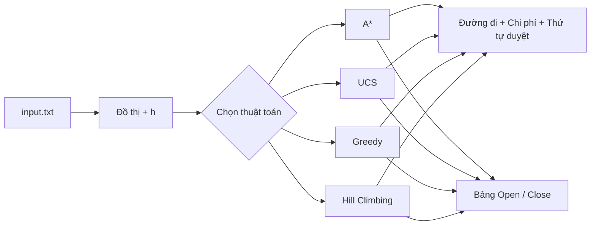
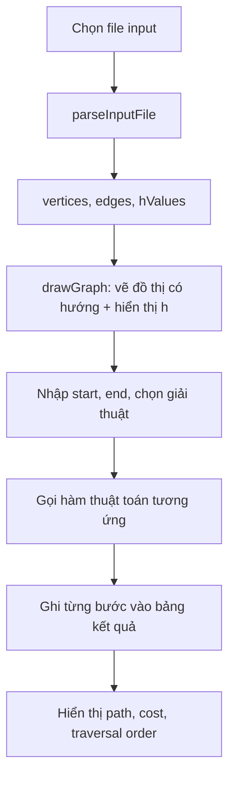
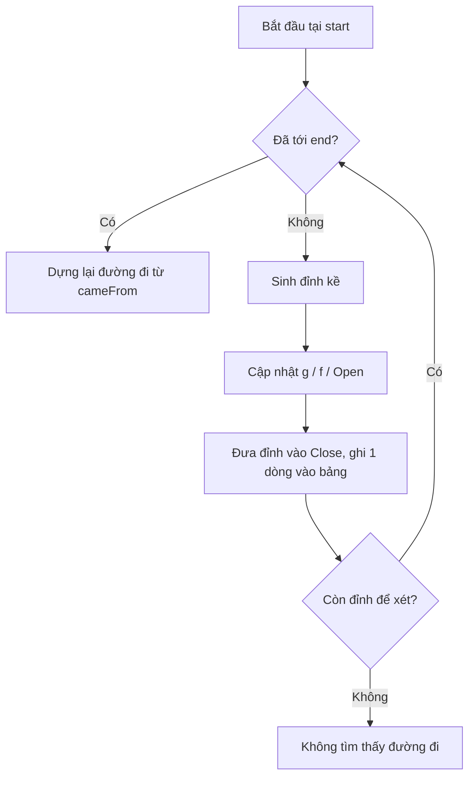

# Artificial_Intelligence_CT332

Trình trực quan hóa các thuật toán tìm đường trong không gian trạng thái (A*, UCS, Greedy, Hill Climbing) bằng JavaScript thuần — học phần CT332 Trí tuệ nhân tạo.

---

## 1. Tóm tắt

Ứng dụng web cho phép **nạp đồ thị từ file `.txt` → chọn đỉnh đầu/cuối → chọn thuật toán → xem đường đi, thứ tự duyệt và bảng Open/Close từng bước**.



| Thành phần | Công nghệ |
|---|---|
| Giao diện | HTML, Bootstrap 5 |
| Vẽ đồ thị | vis-network |
| Thuật toán | JavaScript (không backend) |

---

## 2. Phương pháp

### 2.1 Luồng xử lý chung



### 2.2 Định dạng input

```
A 5 B 3 C 0          # dòng 1: đỉnh và giá trị h  → "đỉnh h đỉnh h ..."
A B 2                # các dòng sau: "từ đến trọng_số"
B C 4
```

Đồ thị **có hướng**, trọng số cạnh dương, `h` là heuristic của từng đỉnh.

### 2.3 Bốn thuật toán

| Thuật toán | Chọn đỉnh mở rộng | Cấu trúc | Đảm bảo tối ưu |
|---|---|---|---|
| **A\*** (`gtAsao.js`) | `f = g + h` nhỏ nhất | Open + Close, có cập nhật khi tìm đường tốt hơn | Có (h chấp nhận được) |
| **UCS** (`UCS.js`) | `g` nhỏ nhất | Open + Close | Có |
| **Greedy** (`Greedy.js`) | `h` nhỏ nhất | Close | Không |
| **Hill Climbing** (`hillClimbing.js`) | Láng giềng chưa duyệt có `h` nhỏ nhất | Close | Không, có thể kẹt cực trị cục bộ |



### 2.4 Cấu trúc thư mục

```
├── index.html        # giao diện + bố cục 3 cột
├── javascript.js     # đọc file, vẽ đồ thị, điều phối thuật toán
├── gtAsao.js         # A*
├── UCS.js            # Uniform Cost Search
├── Greedy.js         # Greedy Best-First
├── hillClimbing.js   # Hill Climbing
└── input*.txt        # đồ thị mẫu
```

### 2.5 Chạy thử

```bash
git clone https://github.com/huynhthanhphong231004IT/Artificial_Intelligence_CT332.git
# mở index.html bằng trình duyệt → Chọn File (input.txt) → Tải → Tìm đường đi
```

> **Lưu ý:** `index.html` gọi `ucs.js` và `greedy.js` (chữ thường) trong khi file thực tế là `UCS.js`, `Greedy.js`. Trên Windows/macOS chạy bình thường; trên Linux hoặc GitHub Pages cần đổi tên file hoặc sửa thẻ `<script>` cho khớp.

---

## 3. Đóng góp

So với các công cụ minh họa tìm kiếm thường gặp (chỉ hoạt ảnh đường đi trên lưới/mê cung, hoặc mã giáo trình chạy console):

| | Công cụ thông thường | Dự án này |
|---|---|---|
| Dữ liệu đầu vào | Cố định hoặc vẽ tay trên lưới | **Đồ thị bất kỳ nạp từ file `.txt`**, kèm `h` |
| Quá trình chạy | Chỉ hiện kết quả/hoạt ảnh | **Bảng từng bước**: đỉnh xét → đỉnh sinh ra → Open → Close, kèm `(cha, g, h, f)` |
| Thuật toán | Thường 1–2 loại | **4 thuật toán cùng một giao diện, cùng một input** để so sánh trực tiếp |
| Giới hạn thuật toán | Ít được nêu | **Hill Climbing báo kẹt cực trị cục bộ** khi không còn láng giềng tốt hơn |
| Triển khai | Cần cài môi trường/server | **Thuần client**: mở `index.html` là chạy |

**Đóng góp chính:** biến các bước chạy tay trên giấy (bảng Open/Close trong giáo trình) thành kết quả tự động, đối chiếu được ngay với lời giải của bài tập, trên cùng một đồ thị cho cả bốn thuật toán.

---

## 4. Kết luận

- Hoàn thành bộ công cụ trực quan cho **4 thuật toán tìm kiếm** với đầu vào linh hoạt và bảng giải trình từng bước.
- Phù hợp để **học, kiểm tra bài tập và so sánh** giữa tìm kiếm mù (UCS), có thông tin (A\*, Greedy) và cục bộ (Hill Climbing).

**Hướng phát triển:** thêm BFS/DFS, đo số đỉnh mở rộng/thời gian để so sánh định lượng, cho phép chỉnh sửa đồ thị trực tiếp trên giao diện, mở rộng sang điều khiển tác nhân trong môi trường Pacman.
